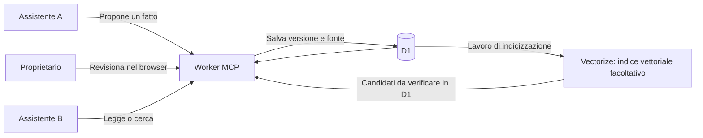

# Shared Memory MCP — una memoria comune tra assistenti AI

**Il mio esperimento con Cloudflare Workers, MCP e una memoria personale da usare con più client. Codice, spiegazioni, prompt ed esempi per riprodurlo.**

Passare da un assistente all'altro può significare spiegare di nuovo progetti,
preferenze e decisioni già prese. Questo progetto nasce dal desiderio di tenere
quel contesto in un posto comune, consultabile dai client autorizzati.

Ho raccolto qui il nucleo riutilizzabile della soluzione: un servizio su
**Cloudflare Workers + D1**, una demo locale e un percorso per adattarlo al
proprio account. Le risorse dei piani gratuiti sono il punto di partenza per
l'uso personale; la ricerca semantica è facoltativa.

È un progetto personale open source con licenza Apache-2.0.
La memoria per agenti è un tema già esplorato: il contributo di questo repository
è rendere ispezionabile e ripetibile un caso pratico, con le sue scelte e i suoi
limiti. [Progetti affini e riferimenti](docs/scope.md) · [English README](README.md).

**Stato:** sperimentale 0.3.0. Il nucleo estratto ha superato una prova su
un'installazione cloud nuova, con dati inventati, vera approvazione GitHub e
ricerca BGE-M3/Vectorize. È incluso anche OAuth MCP facoltativo: nelle
[verifiche](docs/verification.md) sono distinte le prove e i limiti di ogni parte.

Le guide, il prompt, gli esempi e l’interfaccia di revisione sono in inglese.
Le fixture semantiche italiane restano abbinate ai loro embedding precalcolati.

La 0.3.0 aggiunge scadenza bearer a 30 giorni, sessioni di revisione da 12 ore,
consenso OAuth con permessi minimi, controllo preventivo della configurazione,
backup D1 cifrati e un confronto ripetibile delle ricerche. I backup periodici
richiedono una pianificazione scelta dall’operatore. Il confronto usa dati
inventati e non dimostra un vantaggio sul corpus personale.
Vedi [backup](docs/backup.md), [ricerca](docs/retrieval-evaluation.md) e
[aggiornamento dalla 0.2.x](docs/deployment.md#upgrading-02x-to-030).

## Parti da qui

| Se vuoi… | Apri |
| --- | --- |
| Capire il risultato senza installare nulla | [I tre esempi](examples/README.md) e [l'output registrato](examples/sample-output.json) |
| Vederli funzionare sul tuo computer | [Riproduzione passo per passo](REPRODUCE.md) |
| Farti accompagnare da un assistente di programmazione | [Prompt da copiare](PROMPT.md) |
| Preparare una tua istanza cloud | [Installazione](docs/deployment.md) e [costi](docs/costs.md) |
| Leggere il funzionamento interno | [Architettura](docs/architecture.md), [client MCP](docs/clients.md) e [verifiche](docs/verification.md) |

## Il problema, con un esempio

Immagina di aver confermato con un assistente una preferenza o una decisione di
progetto. Vuoi che un secondo assistente recuperi lo stesso dato, sappia da dove
arriva e riconosca una correzione successiva.

Nell'esempio inventato del repository il client A propone una preferenza del
progetto Aurora. Il proprietario la approva. Il client B può allora leggere:

```json
{
  "read_by_client_b": "In the fictional Aurora project, I prefer training in the morning.",
  "version": 1,
  "source": "fictional walkthrough"
}
```

La memoria è conservata dal servizio comune. I client devono essere configurati
per usarlo: non vengono importate automaticamente le chat e non si sincronizzano
le memorie native di qualunque applicazione.

## Perché questa ricetta

| Componente | Cosa fa | Perché l'ho scelto per questo caso |
| --- | --- | --- |
| Cloudflare Workers | Riceve le richieste MCP e serve la pagina di revisione | Il servizio di memoria non richiede una VM o un computer personale sempre acceso |
| D1 | Conserva testi dei fatti, fonti, versioni, approvazioni e lavori da completare | Mantiene lo stato persistente in un database interrogabile e separato dalle chat |
| MCP | Offre strumenti come proporre, leggere e cercare un fatto | Più client compatibili possono usare lo stesso contratto |
| Revisione del proprietario | Decide quali proposte diventano memoria | Una proposta del modello rimane distinguibile da una decisione confermata |
| Ricerca lessicale | Trova per parole e identificativi | Permette di iniziare con Workers e D1, senza inferenza per la ricerca |
| Workers AI, facoltativo | Calcola gli embedding, le rappresentazioni numeriche dei testi | Aggiunge la trasformazione necessaria alla ricerca per significato |
| Vectorize, facoltativo | Conserva i vettori e trova quelli semanticamente vicini alla domanda | Offre l'indice di ricerca semantica, ricostruibile dai fatti in D1 |

**In pratica: testi e stato in D1, vettori in Vectorize.** Il Worker coordina le
operazioni; Workers AI calcola gli embedding quando la ricerca semantica è
attivata. I risultati vengono poi verificati contro la versione corrente in D1.
La configurazione di base usa D1 e ricerca lessicale, senza indice vettoriale.

Il modello cloud BGE-M3 produce vettori da **1.024 componenti**; la demo locale
usa invece vettori MiniLM precalcolati da **384 componenti**. Sono modelli e
indici distinti, come descritto nell'[architettura](docs/architecture.md).

Ogni persona installa la propria istanza nel proprio account e ne può adattare
il codice. L'account, il database e gli accessi sono gestiti da chi la usa;
Cloudflare fornisce l'infrastruttura e tratta i dati del servizio.

Il piano gratuito offre risorse utili per iniziare, con quote finite. La misura
dei consumi della propria istanza è parte della verifica: richieste, CPU,
database e inferenza hanno limiti diversi. Ho raccolto i riferimenti e il loro
perimetro nella [pagina sui costi](docs/costs.md). L'assistente che produce le
risposte continua ad avere i propri requisiti e gli eventuali propri costi.

## Come si muove un'informazione



Un fatto contiene testo, fonte, data di osservazione, validità e versione.
Quando un client propone una modifica indica la versione da cui parte. Il
proprietario revisiona il contenuto; il salvataggio aggiorna registro, ricevuta
e lavoro di indicizzazione nella stessa transazione.

Un'altra applicazione può leggere quel fatto usando i propri permessi. Una
ricerca può aiutare a trovarlo, ma il testo restituito viene verificato contro
la versione corrente del database.

## Provalo sul tuo computer

Servono **Node 22.22.x** e npm. Non servono account Cloudflare, chiavi API o dati
personali per la demo. L'API SQLite di questa versione Node emette un avviso
sperimentale: è previsto.

Da una copia locale del repository:

```sh
npm ci --ignore-scripts
npm run demo:scenarios
```

Il primo comando scarica le dipendenze fissate nel lockfile. La demo usa poi
SQLite in memoria, due client dell'SDK MCP e un revisore simulato. Non apre porte
e non chiama servizi remoti. Ogni caso parte da un database nuovo e contiene
asserzioni che controllano l'esito.

Per un singolo caso o un output JSON:

```sh
npm run demo:scenarios -- --case 1
npm run demo:scenarios -- --case 2
npm run demo:scenarios -- --case 3
npm run demo:scenarios -- --json
```

### 1. Una preferenza passa da un client all'altro

Prima dell'approvazione il client B vede zero fatti correnti. Dopo la conferma
simulata, legge la stessa preferenza proposta da A, con fonte e versione 1.
Questo è il comportamento di base che volevo rendere riutilizzabile.

### 2. Una decisione viene corretta

Due client lavorano sulla versione 1 di una scadenza. Il primo salva la versione
2; il tentativo del secondo, rimasto sulla vecchia versione, riceve
`VERSION_CONFLICT`. La lettura corrente mostra la decisione aggiornata e la
vecchia rimane consultabile come storica.

### 3. Gli embedding non rispondono

Il fatto risulta `stored` mentre l'indice è `pending`. La lettura per ID rimane
disponibile; la ricerca ibrida usa il canale lessicale e dichiara la degradazione.
Al ripristino del componente simulato, il job indicizza il fatto senza duplicare
la scrittura.

La demo usa vettori MiniLM **precalcolati** su testi inventati e un indice locale
di prova. Non esegue inferenza dal vivo e non misura la qualità generale della
ricerca. I dettagli e i risultati attesi sono negli [esempi](examples/README.md).

## Il prompt per riprodurlo e adattarlo

[PROMPT.md](PROMPT.md) contiene un blocco da incollare in un assistente di
programmazione dopo aver aperto il repository. Gli chiede di:

1. Leggere il codice e spiegare il percorso dell'informazione.
2. Riprodurre la demo e riportare gli esiti effettivi.
3. Verificare la compatibilità dei client che vuoi collegare.
4. Preparare una configurazione per il tuo account, mantenendo i controlli.

Il prompt lavora sulla versione presente dei sorgenti. Così le modifiche possono
essere confrontate e i risultati verificati dagli stessi esempi. La procedura
completa è in [REPRODUCE.md](REPRODUCE.md).

## Una scelta che vale la pena discutere

**Salvare il fatto e indicizzarlo sono due responsabilità distinte.** È una delle
scelte centrali del progetto: dopo un salvataggio riuscito, un guasto del modello
di embedding deve lasciare il dato leggibile e il lavoro di ricerca recuperabile.

Per questo il database conserva anche un job durevole. Il costo è dover gestire
retry, versioni dell'indice e richieste ripetute. L'esempio 3 rende visibile questo
compromesso. L'[architettura](docs/architecture.md) spiega transazioni, ricevute,
lease e controlli dei risultati per chi vuole approfondire.

## Dal computer al proprio account Cloudflare

Il [template](config/wrangler.example.json) è disattivato e contiene identificativi
di esempio. La [guida](docs/deployment.md) spiega come preparare un database nuovo,
un indirizzo HTTPS e il login GitHub per la revisione. Per una prova personale è
possibile usare il nome host Workers; un dominio acquistato è facoltativo.

L'endpoint `/memory/mcp` accetta **bearer revocabili** e **OAuth facoltativo**
per i connector remoti: discovery, identità pubblicata (CIMD), registrazione
dinamica, PKCE e refresh. I primi client previsti sono Claude, ChatGPT e OpenCode.
Il proprietario sceglie collection e permessi; collegare un'app non approva
automaticamente i fatti che proporrà. Vedi [client](docs/clients.md) e
[configurazione OAuth](docs/oauth.md).

**Testato con OpenCode e ChatGPT. Test con Claude da fare.**
Le [verifiche](docs/verification.md) e il
[resoconto ChatGPT](docs/chatgpt-rehearsal.md) documentano flussi osservati ed evidenze.

Gli strumenti esposti sono `propose_fact`, `put_fact`, `delete_fact`, `get_fact`,
`list_facts` e `search_facts`. Il [contratto dei client](docs/clients.md) descrive
trasporto, conferme e permessi. La ricerca semantica e il suo cron si attivano
esplicitamente dopo aver valutato bisogno, trattamento dei dati e consumi.

## Stato delle prove e limiti

Il repository comprende test nativi SQLite, prove nel runtime workerd/D1 locale,
una demo con due client SDK e i tre scenari descritti qui. Puoi ripeterli con:

```sh
npm test
npm run test:workerd
npm run demo
npm run demo:scenarios
npm run build
npm run check
```

Le prove workerd aprono soltanto porte loopback temporanee e includono un riavvio.
Identità GitHub e backend vettoriale restano simulati. `build` usa `--dry-run`;
`check` controlla fixture, schema, link e separazione dei moduli pubblici.
Gli esiti osservati sono nelle [verifiche](docs/verification.md).

Il [workflow Verify](https://github.com/maizitto/shared-memory-mcp/actions/workflows/ci.yml)
esegue su Ubuntu con Node 22.22.2: 127 test nativi, 29 workerd, demo SDK,
tre scenari, confronto della ricerca, build dry-run e controlli del pacchetto.
Le [verifiche](docs/verification.md) distinguono risultati osservati, prove
cloud e collaudi nelle app.

Il perimetro iniziale è un proprietario con i propri client, fino a 200 ID di
fatti non cancellati per collection e 8.000 unità UTF-16 per testo. Le letture e
ricerche sono limitate. Un risultato di ricerca vuoto non dimostra l'assenza di
un fatto. Capacità cloud a pieno carico e costi a regime restano da qualificare.

I dati sono leggibili dal servizio; non c'è cifratura end-to-end. I contenuti
letti da un'app AI possono arrivare al suo fornitore di modelli. Sono disponibili
versioni, cancellazione, purge ed export; il [recupero offline](docs/recovery.md)
copre una collection e il suo lavoro di ricostruzione, con limiti espliciti.
Per le altre separazioni di fiducia vedi [SECURITY.md](SECURITY.md).

## Riferimenti e contributi

Esistono approcci vicini, tra cui
[Second Brain su Cloudflare](https://github.com/rahilp/second-brain-cloudflare),
[Open Brain on Cloudflare](https://github.com/aspitz/open-brain-cf),
[MemHeaven](https://github.com/nazar256/memheaven) e
[MCP Memory Service](https://github.com/doobidoo/mcp-memory-service).
La sezione [scope](docs/scope.md) contestualizza il progetto e le prove precedenti.

Il repository conserva
[provenienza dell'estrazione](docs/extraction.json), [riferimenti di terze parti](THIRD_PARTY.md)
e [licenza Apache-2.0](LICENSE). Il codice applicativo dei progetti citati non è
incluso in questa distribuzione.

Mi interessa confrontarmi su tre aspetti: quanto è chiaro il setup, quando serve
una memoria comune tra strumenti e quali informazioni vale davvero la pena
conservare. Se provi la procedura, un esempio riproducibile o un passaggio che
non si capisce sono contributi utili. Le indicazioni per proporre modifiche sono
in [CONTRIBUTING.md](CONTRIBUTING.md).
