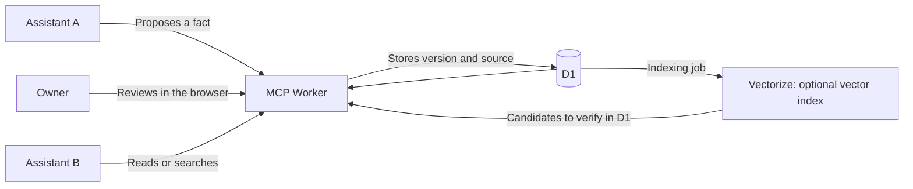

# Shared Memory MCP — shared context across AI assistants

**A personal experiment with Cloudflare Workers, MCP and persistent memory for multiple clients. Code, explanations, a reusable prompt and runnable examples.**

[Leggi in italiano](README.it.md).

Switching between assistants can mean explaining the same projects, preferences
and decisions again. I built this project to keep that context in a common place
that authorized clients can consult.

This repository contains the reusable core: a **Cloudflare Workers + D1** service,
a local demo and a walkthrough for adapting it to your own account. Resources in
the free plans are the starting point for personal use; semantic search is optional.

This is a personal open-source project under Apache-2.0. Agent memory is an
established area. The contribution here is an inspectable, reproducible case study,
including its design choices and limits. See [related projects](docs/scope.md).

**Status:** experimental 0.3.0. The standalone memory core passed a bounded
cloud rehearsal on new isolated resources in the existing owner's account,
with fictional data, real GitHub owner approval and BGE-M3/Vectorize retrieval.
Optional MCP OAuth is now included; see
[verification](docs/verification.md) for its separate evidence and limits.

## Start here

| If you want to… | Open |
| --- | --- |
| Understand the result without installing anything | [Three examples](examples/README.md) and [recorded output](examples/sample-output.json) |
| Run the examples on your computer | [Step-by-step reproduction](REPRODUCE.md) |
| Use a coding assistant to explore and adapt the project | [Copyable prompt](PROMPT.md) |
| Prepare your own cloud instance | [Deployment](docs/deployment.md) and [costs](docs/costs.md) |
| Read the internals | [Architecture](docs/architecture.md), [MCP clients](docs/clients.md) and [verification](docs/verification.md) |

## The problem, with an example

Suppose you confirm a preference or a project decision with one assistant. You
want another assistant to retrieve the same information, know where it came from
and recognize a later correction.

In this repository's fictional Aurora project, client A proposes a preference.
The owner approves it. Client B can then read:

```json
{
  "read_by_client_b": "In the fictional Aurora project, I prefer training in the morning.",
  "version": 1,
  "source": "fictional walkthrough"
}
```

The common service holds the memory. Clients must be configured to use it. It
does not automatically import conversations or synchronize every application's
built-in memory.

## Why these components

| Component | Role | Why I chose it for this case |
| --- | --- | --- |
| Cloudflare Workers | Handles MCP requests and serves the review page | The memory endpoint needs no VM or personal computer running continuously |
| D1 | Stores fact text, sources, versions, approvals and pending jobs | Keeps persistent state in a queryable database outside the chat history |
| MCP | Exposes tools for proposing, reading and searching facts | Compatible clients can use the same contract |
| Owner review | Decides which proposals become memory | Keeps a model's proposal distinguishable from a confirmed decision |
| Lexical search | Finds facts by words and identifiers | Allows a Workers + D1 starting point without model inference for search |
| Workers AI, optional | Computes embeddings, the numeric representations of text | Adds the transformation needed for semantic search |
| Vectorize, optional | Stores vectors and retrieves semantic neighbors | Provides a search index that can be rebuilt from D1 facts |

**Text and state live in D1; vectors live in Vectorize.** The Worker coordinates
the operations, and Workers AI computes embeddings when semantic search is enabled.
Results are then checked against the current canonical version in D1. The basic
configuration uses D1 and lexical search without a vector index.

The cloud embedding model is **BGE-M3, with 1,024 numeric components per vector**.
The local semantic demo uses precomputed MiniLM vectors with 384 components.
These are different models and indexes; see [architecture](docs/architecture.md).

Each person runs an instance in their own account and can adapt the code. The
operator manages the account, database and access; Cloudflare supplies the
infrastructure and processes the service's data.

Free plans have finite allowances. Measuring your instance's usage is part of
validation: requests, CPU, database operations and inference have different
limits. The [cost guide](docs/costs.md) explains their scope. The assistant that
generates responses still has its own requirements and possible costs.

## How information moves



A fact has text, a source, observation time, validity and a version. A client
proposing a change supplies the version it started from. The owner reviews the
content; saving updates the ledger, receipt and indexing job in one transaction.

Another application can read that fact within its permissions. Search helps find
it, and the returned text is checked against the database's current version.

## Try it locally

You need **Node 22.22.x** and npm. The demo needs no Cloudflare account, API keys
or personal data. This Node version's SQLite API emits an experimental warning;
that is expected.

From a local copy of the repository:

```sh
npm ci --ignore-scripts
npm run demo:scenarios
```

The first command downloads the dependencies pinned in the lockfile. The demo
then uses in-memory SQLite, two MCP SDK clients and a simulated reviewer. It
opens no ports and calls no remote services. Each case starts with a new database
and asserts its expected outcomes.

To run one case or get JSON output:

```sh
npm run demo:scenarios -- --case 1
npm run demo:scenarios -- --case 2
npm run demo:scenarios -- --case 3
npm run demo:scenarios -- --json
```

### 1. A preference reaches another client

Before approval, client B sees zero current facts. After simulated approval and
commit, it reads the preference proposed by A, with its source and version 1.
This is the basic behavior I wanted to make reusable.

### 2. A decision gets corrected

Two clients work from version 1 of a deadline. The first saves version 2; the
second client's stale write gets `VERSION_CONFLICT`. The current read shows the
updated decision, and the previous version remains available as history.

### 3. Embeddings become unavailable

The fact is `stored` while its index is `pending`. Reading by ID still works;
hybrid search uses the lexical channel and reports degradation. Once the
simulated component recovers, the job indexes the fact without duplicating the
write.

The semantic demo uses **precomputed** MiniLM vectors over fictional text and a
local test index. Its Italian semantic fixtures are retained with their original
vectors. It runs no live inference and does not measure general retrieval quality.
The [examples guide](examples/README.md) explains the expected results.

## Check retrieval before adding components

`npm run evaluate:retrieval` compares the same labelled development questions
across lexical, semantic and hybrid search. In the small committed fixture,
lexical and hybrid find the expected fact in 3 of 4 positive queries; semantic
finds it in 2. This is not a held-out or real-corpus benchmark. See
[retrieval evaluation](docs/retrieval-evaluation.md) for scope and explicit custom
datasets. No inference service or personal-data import is involved.

## A prompt to reproduce and adapt the project

[PROMPT.md](PROMPT.md) contains a block to paste into a coding assistant after
opening the repository. It asks the assistant to:

1. Read the code and explain the information flow.
2. Reproduce the demo and report observed results.
3. Check compatibility with the clients you want to connect.
4. Prepare configuration for your account while preserving the controls.

The prompt works with the versioned source in this repository. Changes can be
compared and behavior checked against the same examples. The full procedure is
in [REPRODUCE.md](REPRODUCE.md).

## A design choice to discuss

**Saving a fact and indexing it are separate responsibilities.** After a
successful save, an embedding-model outage should leave the fact readable and
its search work recoverable.

The database therefore also stores a durable indexing job. The tradeoff is
handling retries, index versions and repeated requests. Example 3 makes this
visible. The [architecture guide](docs/architecture.md) covers transactions,
receipts, leases and result validation.

For the declared personal scale, lexical search may be enough. There is no
measured retrieval advantage for embeddings on the owner's corpus. Keep semantic
search optional; the [architecture guide](docs/architecture.md#why-start-with-lexical-search)
explains the tradeoff and what to measure.

## From your computer to your Cloudflare account

The [configuration template](config/wrangler.example.json) is disabled and uses
placeholder identifiers. The [deployment guide](docs/deployment.md) explains how
to prepare a fresh database, an HTTPS address and GitHub sign-in for owner review.
A Workers hostname is an option for a personal trial; a purchased domain is optional.
Run `npm run doctor -- --config config/worker.local.json` on your operator config
to catch common mistakes before deploy; it checks offline configuration only.

The `/memory/mcp` endpoint accepts **revocable bearer tokens** and optional
**OAuth for remote app connectors**. OAuth includes discovery, published client
identity (CIMD), dynamic registration fallback, PKCE and refresh. The initial
targets are Claude, ChatGPT and OpenCode. Owner-selected collections and
read/write permissions are checked in D1; connecting an app still requires
separate approval for each fact change. See [client setup](docs/clients.md) and
[OAuth deployment](docs/oauth.md).

**Tested with OpenCode and ChatGPT. Claude testing is planned.**
The [verification guide](docs/verification.md) and
[ChatGPT rehearsal](docs/chatgpt-rehearsal.md) record the observed flows and evidence.

The tools are `propose_fact`, `put_fact`, `delete_fact`, `get_fact`, `list_facts`
and `search_facts`. The [client contract](docs/clients.md) describes transport,
confirmation and permissions. Semantic search and its scheduled job are enabled
explicitly after considering the need, data handling and resource usage.

## Verification and limits

The repository includes native SQLite tests, tests in the local workerd/D1
runtime, a two-client SDK demo and the three scenarios above. Run them with:

```sh
npm test
npm run test:workerd
npm run demo
npm run demo:scenarios
npm run build
npm run check
```

The [Verify workflow](https://github.com/maizitto/shared-memory-mcp/actions/workflows/ci.yml)
runs on Ubuntu with Node 22.22.2: 127 native tests, 29 workerd tests, the SDK
demo, three scenarios, retrieval comparison, dry-run build and package checks.
See [verification](docs/verification.md) for observed results, scope and the
separate cloud and app rehearsals.

The workerd tests use temporary loopback ports and include a restart. GitHub
identity and the vector backend are simulated. `build` uses `--dry-run`; `check`
checks fixtures, schema, links and the public bundle boundary.

The initial scope is one owner and their clients, up to 200 non-deleted fact IDs
per collection and 8,000 UTF-16 code units per text. Reads and searches are bounded.
An empty search result does not prove a fact is absent. Full-load cloud capacity
and ongoing costs still need qualification.

The service can read stored data; there is no end-to-end encryption. Content an
AI app reads may reach its model provider. Versions, deletion, purge and export
are available. [Offline recovery](docs/recovery.md) covers one collection and its
reindexing work, with explicit limits. An optional [encrypted D1 snapshot command](docs/backup.md) supports operator
scheduling; no backup job is installed automatically. D1 recovery into a fresh
cloud database has been checked separately from full-service recovery, which
remains unqualified.
Approved facts can still carry prompt injection into a reading app; see
[SECURITY.md](SECURITY.md) for credential lifetimes and trust boundaries.

## References and contributions

Related approaches include
[Second Brain on Cloudflare](https://github.com/rahilp/second-brain-cloudflare),
[Open Brain on Cloudflare](https://github.com/aspitz/open-brain-cf),
[MemHeaven](https://github.com/nazar256/memheaven) and
[MCP Memory Service](https://github.com/doobidoo/mcp-memory-service).
The [scope document](docs/scope.md) explains the project's context and earlier
experiments.

The repository preserves [extraction provenance](docs/extraction.json),
[third-party references](THIRD_PARTY.md) and the [Apache-2.0 license](LICENSE).
Application code from the related projects is not included in this distribution.

I am interested in discussing setup clarity, when shared memory helps across
tools and which information is worth keeping. If you try the walkthrough, a
reproducible example or an unclear setup step is useful feedback. See
[CONTRIBUTING.md](CONTRIBUTING.md) to propose a change.
